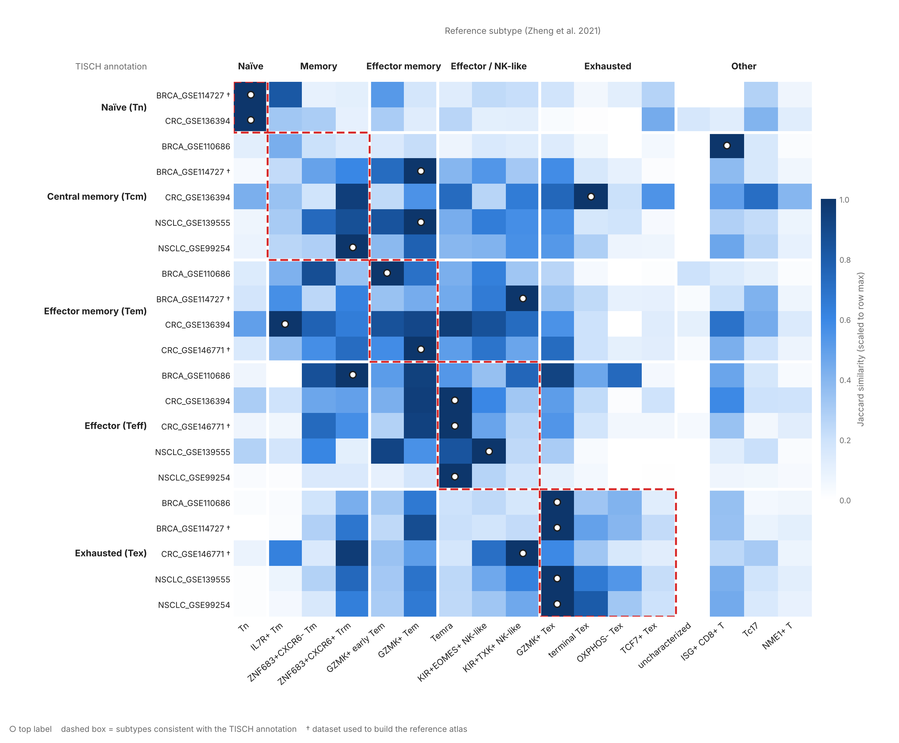
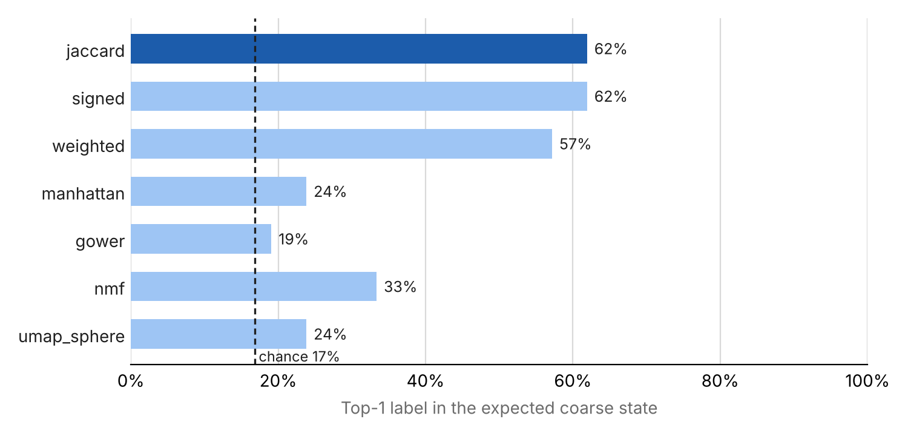

# Labeling CD8⁺ T Cell Subtypes Across Tumor Microenvironments

[](https://github.com/kcortes133/7712Project/actions/workflows/tests.yml)


This tool maps CD8⁺ T cell clusters from any single-cell RNA-seq study onto the **17 pan-cancer CD8⁺ T cell
subtypes** of [Zheng et al., *Science* 2021](https://doi.org/10.1126/science.abe6474). CD4⁺ T cells, with 24
subtypes, are supported as well. It compares their
upregulated gene signatures with Jaccard similarity. It accepts Scanpy (`.h5ad`), Seurat (`FindAllMarkers`) and
[TISCH](http://tisch.comp-genomics.org/) inputs. It can also estimate the subtype **composition** of each cluster
from individual cells.



*Each row is a CD8⁺ cluster from one of six public tumor datasets, grouped by its TISCH annotation. Each column is
a reference subtype, grouped by coarse state. The dot marks the best match. Dashed boxes show where a label that
agrees with TISCH would fall. Most dots land inside their box, at much finer resolution than TISCH's five labels.
The central-memory rows are the exception, discussed below.*

> Course project for 7712 (CPBS) by Katherina Cortes. The full write-up is in
> [`docs/Project_Report.pdf`](docs/Project_Report.pdf) and the slides are in
> [`docs/Project_Presentation.pptx`](docs/Project_Presentation.pptx).

### Timeline

| When | What |
|---|---|
| **Spring 2022** | Original project: Jaccard labeling of CD8⁺ clusters, analysis of six TISCH datasets, report and slides (first commit May 2022). |
| **October 2026** | Repository restructured into a package with a CLI and tests. Added: formal evaluation, Scanpy/Seurat input, per-cell composition, CD4⁺ support, and a benchmark against other annotation tools. |

The core method and results (Table 2 of the report, reproduced exactly by `tests/test_reproduce_report.py`)
date from 2022. General-purpose annotation tools existed then: SingleR (2019), ProjecTILs (2021) and CellTypist
(preprint 2021, *Science* May 2022). This project took a different angle. It used a **tumor-specific, pan-cancer
reference** that includes the exhausted sub-states. The [benchmark](#benchmark-against-other-tools) added in 2026
tests how that choice compares.

---

## Motivation

The state of the CD8⁺ T cells in a tumor (naïve, effector, memory, progenitor-exhausted, terminally
exhausted, …) is linked to how patients respond to immune checkpoint blockade and CAR-T therapy.
Most single-cell studies re-define their own T cell subtypes, which makes it hard to compare results
across cohorts and cancer types.

Zheng et al. (2021) built a pan-cancer reference: 17 CD8⁺ T cell meta-clusters shared across
21 cancer types. This project asks a simple question about that reference:

**Given the differentially expressed genes of a T cell cluster from a new study, which of the
17 reference subtypes does it most resemble?**

## How it works

```
reference signatures (Zheng 2021, Table S3)        query clusters (your DE results)
  17 subtypes × genes, combined effect size           cluster × genes, log2FC
                 │                                                    │
                 └──── keep genes with effect size > 0.15 ────────────┘
                                         │
                 restrict query genes to the reference gene universe (4,549 genes)
                                         │
              J(A, B) = |A ∩ B| / |A ∪ B|   for every query cluster × reference subtype
                                         │
          ranked subtype labels  +  which exhaustion / effector marker genes are up
```

1. **Reference signatures**: For each of the 17 subtypes, take the signature genes from Zheng et al.
   Table S3 with combined effect size (`comb.ES`) > 0.15. This is the same cut-off the authors used.
2. **Query signatures**: For each cluster, take the genes with log2FC > 0.15 that also appear in the reference.
3. **Score**: Compute the Jaccard similarity between the query set and every reference set, then rank.
4. **Interpret**: Report which curated marker genes are upregulated in the cluster
   ([`data/markers/marker_gene_sets.csv`](data/markers/marker_gene_sets.csv)). These include exhaustion markers
   (PDCD1, HAVCR2, TOX, …), cytokines and effector molecules, and the genes that separate the exhausted sub-states.

Jaccard only looks at *which* genes are up, not by how much. That makes it robust to the very different
effect-size scales of a meta-analysis effect size and a single-study log2FC.

Two alternative scoring methods are available with `--method`. Both were added to address limitations of the
original method, and both are evaluated [below](#evaluation):

| Method | Score | Idea |
|---|---|---|
| `jaccard` (default) | J(up_q, B) | Overlap of upregulated genes. This is the method from the original report. |
| `signed` | J(up_q, B) − J(down_q, B) | The reference lists only upregulated genes. Genes that are *down* in the query count as evidence against subtypes whose signature contains them. |
| `weighted` | Σ min / Σ max (weighted Jaccard) | Uses effect sizes as within-cluster percentile ranks, which puts both data sources on one 0–1 scale. Reference genes are further weighted by `sig.freq`, the fraction of cancer types in which the gene is significant. |

## Quick start

```bash
git clone https://github.com/kcortes133/7712Project.git && cd 7712Project
pip install -r requirements.txt

# label every CD8+ cluster in the six bundled TISCH datasets
python label_clusters.py --plots
```

### Use it on your own data

```bash
# Scanpy: any .h5ad with log-normalised expression and a cluster column
python label_clusters.py -i my_tcells.h5ad --groupby leiden

# ...and estimate the subtype composition of each cluster from individual cells
python label_clusters.py -i my_tcells.h5ad --groupby leiden --composition

# Seurat: export FindAllMarkers results to CSV first (see below)
python label_clusters.py -i seurat_markers.csv

# any table of per-cluster differential expression
python label_clusters.py -i de.csv --format table --cluster-col group --gene-col names --es-col logfoldchanges

# mouse data: match symbols case-insensitively (an approximate ortholog mapping)
python label_clusters.py -i mouse.h5ad --groupby leiden --uppercase-genes
```

<details>
<summary>Exporting from Seurat</summary>

```r
markers <- FindAllMarkers(seurat_obj, only.pos = FALSE)   # keep down-regulated genes for --method signed
write.csv(markers, "seurat_markers.csv", row.names = FALSE)
```

`avg_log2FC` (Seurat ≥ 4) and `avg_logFC` (Seurat ≤ 3, natural log, converted automatically) are both supported.
Rows with `p_val_adj` > 0.05 are dropped. To use the per-cell `--composition` mode, convert the object to `.h5ad`
(for example with [SeuratDisk](https://github.com/mojaveazure/seurat-disk) or
[zellkonverter](https://bioconductor.org/packages/zellkonverter/)).
</details>

<details>
<summary>Python API</summary>

```python
import sys; sys.path.insert(0, "src")
from cd8_subtyper import load_reference, score_clusters
from cd8_subtyper.adapters import from_anndata
from cd8_subtyper.cellscore import subtype_composition

ref = load_reference()
de = from_anndata(adata, groupby="leiden")            # or from_seurat_markers("markers.csv")
scores = score_clusters(de, ref, method="jaccard")     # clusters x 17 subtypes
scores.idxmax(axis=1)                                  # best label per cluster
subtype_composition(adata, "leiden", ref)              # fraction of cells per subtype
```
</details>

### CD4⁺ T cells

The same atlas defines 24 CD4⁺ subtypes (naïve, memory, Tfh, Th17, several Treg states, …).
Their signatures are in another sheet of Zheng et al. Table S3, which is not bundled here. To enable CD4:

1. Download Table S3 from the paper's [Supplementary Materials](https://doi.org/10.1126/science.abe6474).
2. Convert it and draft the state mapping:
   ```bash
   python scripts/add_cd4_reference.py path/to/science.abe6474_table_s3.xlsx
   ```
   This writes `data/reference/zheng2021_table_s3_cd4_signatures.csv` and a **draft**
   `data/reference/subtype_states_cd4.csv`. Each CD4 subtype's coarse state (Treg, Tfh, Th17, naive, …) is inferred
   from its name. The same rules reproduce the hand-curated CD8 mapping exactly. Review the draft before relying on it.
3. Use `--lineage cd4` everywhere:
   ```bash
   python label_clusters.py --lineage cd4
   python scripts/evaluate.py --lineage cd4
   python scripts/make_figures.py          # adds results/figures/overview_heatmap_cd4.png
   ```

The bundled TISCH datasets already contain 22 CD4⁺ clusters (CD4Tn, CD4Teff, Tfh, Th1, Th2, Th17, Treg) to label.
For evaluation, Tfh and Th1 clusters also accept a mixed Tfh/Th1 state if the atlas has one. TISCH labels with
no matching state in the reference (possibly Th2) are skipped rather than counted as misses.

**Outputs** (in `results/`):

| File | Contents |
|---|---|
| `cluster_labels.csv` | Top-3 subtype labels and scores per cluster, plus the upregulated marker genes in each category |
| `all_subtype_scores.csv` | Score of every cluster against all 17 subtypes (long format) |
| `subtype_composition.csv` | `--composition`: fraction of each cluster's cells assigned to each subtype |
| `figures/<dataset>_<cluster>.png` | `--plots`: bar chart of the 17 scores, with the best match in red |

Non-default methods and lineages add a suffix to the file name, e.g. `cluster_labels_weighted.csv` or
`cluster_labels_cd4.csv`.

## Results

The method was evaluated on six public datasets from three cancer types. All six were preprocessed,
clustered and annotated by TISCH with MAESTRO. Two of them (†) were part of the data used to build the
Zheng et al. atlas and act as controls. The other four are independent.

| Dataset | Cancer | Publication |
|---|---|---|
| BRCA_GSE110686 | Breast | Savas et al., *Nat Med* 2018 |
| BRCA_GSE114727 † | Breast | Azizi et al., *Cell* 2018 |
| CRC_GSE136394 | Colorectal | Lu et al., *Cancer Immunol Res* 2019 |
| CRC_GSE146771 † | Colorectal | Zhang et al., *Cell* 2020 |
| NSCLC_GSE99254 | Lung (NSCLC) | Guo et al., *Nat Med* 2018 |
| NSCLC_GSE139555 | Lung (NSCLC) | Wu et al., *Nature* 2020 |

### Labels

Output of `python label_clusters.py`. The score is in parentheses.

| Dataset | TISCH label | Jaccard #1 | #2 | #3 | Exhaustion markers up |
|---|---|---|---|---|---|
| BRCA_GSE110686 | CD8Tcm | **ISG+ CD8+ T** (0.24) | IL7R+ Tm | GZMK+ Tem | — |
| BRCA_GSE110686 | CD8Teff | **ZNF683+CXCR6+ Trm** (0.09) | GZMK+ Tem | GZMK+ Tex | LAG3 |
| BRCA_GSE110686 | CD8Tem | **GZMK+ early Tem** (0.16) | ZNF683+CXCR6- Tm | GZMK+ Tem | — |
| BRCA_GSE110686 | CD8Tex | **GZMK+ Tex** (0.30) | GZMK+ Tem | ZNF683+CXCR6+ Trm | CXCL13, HAVCR2, LAG3, PDCD1, TIGIT, TNFRSF9, TOX |
| BRCA_GSE114727 † | CD8Tcm | **GZMK+ Tem** (0.23) | GZMK+ early Tem | ZNF683+CXCR6+ Trm | LAG3 |
| BRCA_GSE114727 † | CD8Tem | **KIR+TXK+ NK-like** (0.18) | KIR+EOMES+ NK-like | ZNF683+CXCR6+ Trm | LAG3 |
| BRCA_GSE114727 † | CD8Tex | **GZMK+ Tex** (0.28) | GZMK+ Tem | ZNF683+CXCR6+ Trm | CTLA4, CXCL13, HAVCR2, LAG3, PDCD1, TIGIT, TNFRSF9, TOX |
| BRCA_GSE114727 † | CD8Tn | **Tn** (0.09) | IL7R+ Tm | GZMK+ early Tem | — |
| CRC_GSE136394 | CD8Tcm | **terminal Tex** (0.14) | ZNF683+CXCR6+ Trm | GZMK+ Tex | CTLA4, HAVCR2, PDCD1, TOX |
| CRC_GSE136394 | CD8Teff | **Temra** (0.18) | GZMK+ Tem | KIR+EOMES+ NK-like | — |
| CRC_GSE136394 | CD8Tem | **IL7R+ Tm** (0.08) | Temra | GZMK+ Tem | — |
| CRC_GSE136394 | CD8Tn | **Tn** (0.22) | TCF7+ Tex | Tc17 | — |
| CRC_GSE146771 † | CD8Teff | **Temra** (0.23) | GZMK+ Tem | ZNF683+CXCR6- Tm | LAG3, TIGIT |
| CRC_GSE146771 † | CD8Tem | **GZMK+ Tem** (0.23) | GZMK+ Tex | ZNF683+CXCR6+ Trm | LAG3, TIGIT |
| CRC_GSE146771 † | CD8Tex | **KIR+TXK+ NK-like** (0.24) | ZNF683+CXCR6+ Trm | KIR+EOMES+ NK-like | LAG3, TIGIT, TNFRSF9 |
| NSCLC_GSE139555 | CD8Tcm | **GZMK+ Tem** (0.12) | ZNF683+CXCR6+ Trm | GZMK+ early Tem | LAG3 |
| NSCLC_GSE139555 | CD8Teff | **KIR+EOMES+ NK-like** (0.09) | GZMK+ early Tem | Temra | — |
| NSCLC_GSE139555 | CD8Tex | **GZMK+ Tex** (0.23) | ZNF683+CXCR6+ Trm | GZMK+ Tem | CTLA4, CXCL13, HAVCR2, LAG3, PDCD1, TIGIT, TNFRSF9, TOX |
| NSCLC_GSE99254 | CD8Tcm | **ZNF683+CXCR6+ Trm** (0.23) | GZMK+ Tem | KIR+TXK+ NK-like | LAG3, TOX |
| NSCLC_GSE99254 | CD8Teff | **Temra** (0.51) | KIR+EOMES+ NK-like | KIR+TXK+ NK-like | — |
| NSCLC_GSE99254 | CD8Tex | **GZMK+ Tex** (0.26) | terminal Tex | GZMK+ Tem | CXCL13, HAVCR2, LAG3, PDCD1, TIGIT, TNFRSF9, TOX |

### Takeaways

- **Finer resolution than the source annotation.** Both naïve clusters map to Tn, 4 of 5 effector clusters map to
  Temra or the NK-like effectors, and 4 of 5 exhausted clusters map to GZMK+ Tex. GZMK+ Tex is the progenitor-like
  exhausted state that still expresses effector molecules, a distinction that matters for immunotherapy response.
- **A likely mislabeled cluster.** In CRC_GSE136394 (Lu et al.), the cluster TISCH annotates as *central memory*
  is labeled **terminal Tex**. It also upregulates four canonical exhaustion markers: TOX, CTLA4, HAVCR2 and PDCD1.
- **Exhaustion markers outside exhausted clusters.** Non-exhausted clusters in both breast datasets upregulate
  LAG3. This may flag cells moving toward dysfunction, which a single coarse label hides.
- **Central memory is the weak spot.** Only 1 of 5 TISCH "central memory" clusters maps to a memory subtype.
  The rest look most like effector memory (GZMK+ Tem), ISG+ or exhausted cells. The atlas has no dedicated Tcm
  meta-cluster, so this partly reflects a mismatch between the two labeling schemes rather than pure error.

## Evaluation

`python scripts/evaluate.py` quantifies the agreement shown in the heatmap.

**Ground truth.** TISCH's five coarse labels do not map one-to-one onto the 17 subtypes. Instead, each subtype is
assigned a coarse state: naïve, memory, effector memory, effector, exhausted or other. A label counts as correct
when its state matches the TISCH label. The mapping is a judgement call, so it lives in an editable file,
[`data/reference/subtype_states.csv`](data/reference/subtype_states.csv), with a rationale for each row.

**Baselines.**
- *Chance*: the probability that randomly chosen subtypes would land in the right state (17% for the top label).
- *Permutation test*: for each cluster, its upregulated genes are replaced 1,000 times with random genes from the
  reference universe, keeping the same set size, and the best score is recomputed.



| Method | Top-1 accuracy | Top-3 accuracy | Top-1, independent datasets only |
|---|---|---|---|
| **Jaccard** | **62%** (13/21) | **86%** | **64%** (9/14) |
| Signed | 62% | 81% | 64% |
| Weighted | 57% | 86% | 57% |
| NMF | 33% | – | 36% |
| Manhattan | 24% | – | 29% |
| UMAP sphere | 24% | – | 29% |
| Gower | 19% | – | 21% |
| *Chance* | *17%* | *44%* | *17%* |

- **Jaccard is about 3.6× chance** and puts the right state in its top 3 for 86% of clusters. Accuracy on the four
  independent datasets (64%) is no lower than on all six, so the method is not just recognizing data it was built from.
- **Every cluster beats random gene sets** (permutation p ≤ 0.001 for all 21 clusters, the minimum possible with
  1,000 permutations). The best scores average 0.21, against 0.05 for random sets of the same size. This test is
  easy to pass: it shows the signal is real, not that the label is right. Accuracy is the meaningful number.
- **Per state** (Jaccard): naïve 2/2, exhausted 4/5, effector 4/5, effector memory 2/4, central memory 1/5.

### Did the proposed improvements help?

The report suggested using down-regulated genes and weighting genes by effect size and cross-cancer consistency.
Both are implemented (`--method signed` and `--method weighted`) and evaluated above. **Neither beats plain Jaccard.**

- `signed` changes only two top labels, and neither change affects accuracy. The NSCLC_GSE139555 effector cluster
  moves from KIR+EOMES+ NK-like to Temra (both effector states). The CRC_GSE136394 "central memory" cluster moves from
  terminal Tex to Tc17 (a miss either way). Top-3 accuracy drops slightly.
- `weighted` moves one effector-memory cluster to an NK-like subtype, which is a miss, and one GZMK+ Tex
  cluster to terminal Tex. Weighting by magnitude seems to reintroduce some of the scale sensitivity that sank the
  distance-based methods.

With 21 clusters, a difference of one or two clusters is within noise. The honest conclusion is that the simple
set overlap already captures most of the available signal. The larger remaining limitation is that TISCH clusters
are big and mixed. That is addressed next.

### Per-cell composition for mixed clusters

A cluster that is 70% GZMK+ Tex and 30% terminal Tex has no single correct label. With cell-level data,
`--composition` scores every cell against each subtype's top 50 signature genes (`scanpy.tl.score_genes`),
assigns it to the best match, and reports the mix within each cluster.

This is validated on synthetic data with known mixtures (`tests/test_adapters.py`). Cluster-level Jaccard labels
the 70/30 GZMK+/terminal Tex mixture as OXPHOS- Tex: the right state, but neither true component. The per-cell
composition recovers the 70/30 split to within ±10%. It has not yet been run on real cell-level data, because the
bundled TISCH tables are cluster summaries only.

## Benchmark against other tools

[`benchmark/`](benchmark/) compares this method with **CellTypist**, **SingleR** and **ProjecTILs** on the same
cell-level tumor datasets. Every tool's labels are mapped to shared coarse states and scored against the TISCH
annotations, at both the cluster and the cell level. The other tools are scored leniently, e.g. CellTypist's
"Tcm/Naive" label counts as correct for both states.

| Tool | Reference | Has exhausted states? |
|---|---|---|
| This project | Zheng et al. 2021 pan-cancer TIL meta-clusters | Yes (4 CD8 Tex sub-states) |
| CellTypist | Cross-tissue immune atlas (`Immune_All_Low`) | No |
| SingleR | Monaco sorted blood immune populations | No |
| ProjecTILs | Human CD8/CD4 tumor-infiltrating T cell atlases | Yes (TPEX, TEX) |

```bash
python benchmark/prepare_tisch_cells.py && python benchmark/run_python_tools.py
Rscript benchmark/run_singler.R && Rscript benchmark/run_projectils.R --cd8 <ref.rds> --cd4 <ref.rds>
python benchmark/compare.py
```

**Status:** the scripts are complete. The Python side is tested end to end on synthetic data. Results are pending:
the benchmark needs the cell-level TISCH downloads (`.h5` + cell metadata) in `data/cells/`. See
[`benchmark/README.md`](benchmark/README.md) for the data and setup.

## Earlier approaches (and why they were dropped)

Before Jaccard similarity, I tried four approaches that compare **effect-size vectors** directly instead of
gene sets. The original code is preserved in [`archive/`](archive/). I re-implemented all four on the same inputs in
[`exploratory/alternative_metrics.py`](exploratory/alternative_metrics.py)
(full output: `results/alternative_metrics_comparison.csv`).

| Approach | What it does | Distinct labels used (of 17) | Most common label | Top-1 accuracy |
|---|---|---|---|---|
| **Manhattan distance** | L1 distance between raw effect-size vectors over the 4,549 reference genes | 5 | uncharacterized (13/21) | 24% |
| **Gower distance** | Range-normalized mixed-type distance on effect sizes thresholded at 0.25 | 7 | uncharacterized (14/21) | 19% |
| **NMF** | Non-negative matrix factorization (3 components) of reference + query; nearest subtype in factor space | 8 | terminal Tex (11/21) | 33% |
| **UMAP on a sphere** | UMAP with a haversine output metric fitted on the 17 subtypes; queries projected and matched to the nearest subtype | 4 | ZNF683+CXCR6+ Trm (18/21) | 24% |
| **Jaccard similarity** (final) | Overlap of upregulated gene sets | 11 | GZMK+ Tex (4/21) | 62% |

All four collapsed most clusters onto one or two subtypes regardless of their biology, and none did much better
than chance:

- **Manhattan and Gower** are dominated by vector *magnitude*. The `uncharacterized` subtype has only 5 signature
  genes, so its vector is almost all zeros. A sparse query cluster is therefore "closest" to it. These metrics also
  compare a meta-analysis effect size against a single-study log2FC, two quantities on different scales.
- **NMF** with 3 components cannot represent 17 subtypes. Over half the clusters, memory and effector ones included,
  land nearest the `terminal Tex` factor, which has the largest signature (1,190 genes).
- **UMAP** was fitted on only 17 reference points, too few for a meaningful manifold. Almost every query projects
  next to `ZNF683+CXCR6+ Trm`.

Switching to a **set-based** comparison of which genes are up removed the scale mismatch. It also stopped
subtypes with very large or very small signatures from dominating.

## Repository structure

```
├── label_clusters.py              # CLI: label clusters from any supported input
├── scripts/
│   ├── evaluate.py                # accuracy vs TISCH, chance + permutation baselines, method comparison
│   ├── make_figures.py            # README figures
│   └── add_cd4_reference.py       # install the CD4 signatures from Zheng et al. Table S3
├── benchmark/                     # comparison with CellTypist, SingleR and ProjecTILs (Python + R)
├── src/cd8_subtyper/
│   ├── io.py                      # loaders for the reference, TISCH tables, marker sets, state mapping
│   ├── adapters.py                # Scanpy / Seurat / generic-table input → (Cluster, Gene, ES)
│   ├── signatures.py              # effect-size table → up/down-regulated gene sets
│   ├── scoring.py                 # jaccard / signed / weighted scoring, permutation test
│   ├── similarity.py              # simple set-level Jaccard + marker overlap
│   ├── cellscore.py               # per-cell subtype assignment and cluster composition
│   ├── evaluation.py              # coarse-state accuracy and chance levels
│   └── plotting.py                # per-cluster bars, overview heatmap, evaluation chart
├── tests/                         # pytest suite (run in CI on Python 3.10–3.12)
├── exploratory/
│   └── alternative_metrics.py     # re-run of Manhattan / Gower / NMF / UMAP for comparison
├── data/
│   ├── reference/                 # Zheng et al. 2021 Table S3 (CD8; CD4 optional) + subtype → state mappings
│   ├── cells/                     # cell-level TISCH downloads for the benchmark (git-ignored)
│   ├── tisch/                     # six TISCH per-cluster differential expression tables
│   └── markers/                   # curated exhaustion / effector / Tex-subtype gene sets
├── results/                       # generated labels, scores, evaluation and figures
├── docs/                          # report, slides, proposal, results workbook
└── archive/                       # original exploratory scripts (kept for reference, not maintained)
```

## Testing

```bash
pip install -r requirements.txt -r requirements-dev.txt
pytest
```

The suite (62 tests) covers:
- the similarity and scoring math (the matrix implementation must equal the set-based Jaccard);
- input adapters for Seurat v3/v4, generic tables and `.h5ad` files;
- recovery of known subtypes and mixtures from synthetic single-cell data;
- the permutation test, the evaluation logic and the CLI;
- CD4 support end to end: Table S3 conversion, state inference, labeling and evaluation (with a stand-in reference);
- the benchmark pipeline: TISCH-format `.h5` preparation, this method, CellTypist and the comparison report;
- a **regression test that reproduces Table 2 of the original report exactly**.

## Data sources

- **Reference subtypes:** Zheng L. *et al.* Pan-cancer single-cell landscape of tumor-infiltrating T cells.
  *Science* 374 (2021). Supplementary Table S3. [doi:10.1126/science.abe6474](https://doi.org/10.1126/science.abe6474)
- **Query datasets:** Sun D. *et al.* TISCH: a comprehensive web resource enabling interactive single-cell
  transcriptome visualization of tumor microenvironment. *Nucleic Acids Research* 49, D1420–D1430 (2021).
  Per-cluster "AllDiffGenes" tables were downloaded from [TISCH](http://tisch.comp-genomics.org/).
- **Marker gene sets:** Exhaustion markers, cytokines/effector molecules and Tex-subtype genes as described in
  Zheng et al. (2021).

These files are redistributed here for reproducibility. Please cite the original publications.

## Limitations and future work

- **Evaluation is small and approximate.** There are 21 clusters, and the ground truth is TISCH's own coarse annotation,
  which may itself be wrong (see CRC_GSE136394). A dataset with flow-sorted or CITE-seq-validated subtypes would make a
  stronger benchmark.
- **The per-cell composition mode is validated only on synthetic data.** The next step is to run it on a public
  cell-level dataset.
- **Gene matching is by symbol.** Mouse data needs `--uppercase-genes`, a rough ortholog mapping. A proper ortholog
  table would be better.
- **CD4⁺ results are pending** the Table S3 download. The code path is tested, but no real CD4 labels have been produced yet.
- **The benchmark has not been run on real data yet**, and the R scripts (SingleR, ProjecTILs) are untested.

## Acknowledgements

Thanks to Eric Prince, Lucas Gillenwater, Jim Costello and the CPBS cohort.
